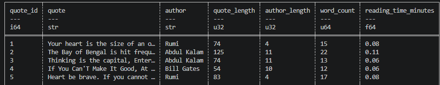

# Web Mining and Applied NLP Project Report

Web Mining and Applied NLP | Project 04 | Example Report-Modification-Custom Project

## Overview

This project introduces structured text data acquisition
using web APIs.

The objective is to retrieve JSON data,
validate its structure,
transform records into a tabular representation,
and persist the results for analysis.

The project demonstrates a modular
Extract, Validate, Transform, Load (EVTL) pipeline
with explicit inputs and outputs.

Apply a technical modification to the example project
and then apply the pipeline to a custom project.

## Tools and Methods

The project uses:

- Python for pipeline orchestration and processing.
- Requests for retrieving JSON data from a web API.
- JSON for representing structured source records.
- Validation checks for confirming expected data structures.
- Polars for tabular transformation and derived features.
- CSV for persistent output.
- Logging for execution records.
- Ruff, ty, and pytest for code verification.
- Zensical and GitHub Pages for published documentation.

The example retrieves post records
from the JSONPlaceholder demonstration API.

The pipeline implements four stages:

- **Extract** - retrieve JSON records and preserve the raw response.
- **Validate** - verify the structure and types of the retrieved records.
- **Transform** - select fields and calculate text lengths.
- **Load** - save the transformed data to a CSV file.

Each stage is implemented as a separate Python module
with explicit inputs and outputs.

## Verification

A successful execution displays:

    Pipeline executed successfully!

The pipeline records execution details in a project log.

The following artifacts are created:

- `data/raw/case_raw.json` - original API response.
- `data/processed/case_processed.csv` - transformed dataset.

-data\raw\goucher_raw.json
-data\processed\goucher_processed.csv

These results demonstrate that the pipeline can
acquire, validate, transform, and persist API data.

Automated tests provide additional verification
of the pipeline's expected behavior.

## Interpretation

Web APIs provide structured access
to externally maintained data.

Successful acquisition does not guarantee
that the data meets analytical requirements.

Validation establishes whether the retrieved
records have an expected structure,
while transformation produces a consistent
representation for subsequent analysis.

The EVTL architecture separates responsibilities,
making pipeline behavior easier to inspect,
test, and maintain.

## Technical Modification

Two fields were added to the example project. Word Count
and estimated reading time. Word count was calculated from
the body of the text of each post. Estimated reading time
was calculated using an average reading speed of 200
words per minute.

## Custom Project Insights and Interpretations

Following the technical modification pipeline above,
a new API JSON file was used https://dummyjson.com/quotes.
The pipeline files were modified for config, pipeline, Stage 2,
and Stage 3 to reflect the custom project. The counts are easier
to interpret with this file given it is in english than the example
file that was in latin. The time to read columns and word count
is interesting and varies by author. The average word count was
16 and average reading time was .08. This is a good start to the
analysis. Recommendations for word cloud visuals and enhancements to
sentient analysis or bigrams, trigrams may present interesting next
steps.

## Documentation Index

- **Home** - this landing page
- [**Project Instructions**](project-instructions.md)
- [**Glossary**](glossary.md)

## Project Links

- [GitHub Repository](https://github.com/BJean-0905/nlp-04-api-text-data)
- [Example Pipeline](https://github.com/BJean-0905/nlp-04-api-text-data/blob/main/src/nlp/pipeline_api_json.py)
- [Example Configuration](https://github.com/BJean-0905/nlp-04-api-text-data/blob/main/src/nlp/config.py)
- [Pipeline Stages](https://github.com/BJean-0905/nlp-04-api-text-data/tree/main/src/nlp)

## Project Resources

- [Project Instructions](project-instructions.md)
- [Professional Python Guide](https://denisecase.github.io/pro-analytics-02/)
- [Professional Python Project Explainer](https://pup-pack.github.io/professional-python-project-explainer/)
